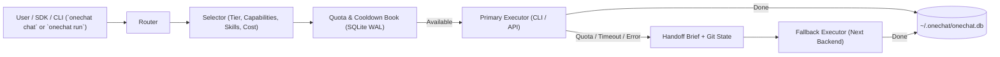

# onechat

[](https://github.com/abolfazl-moeini/onechat/actions/workflows/ci.yml)
[](https://pypi.org/project/onechat-cli/)
[](https://www.python.org/downloads/)
[](https://github.com/abolfazl-moeini/onechat/blob/main/LICENSE)

**The Problem:** You are deep into a coding or debugging session with Claude Code, Codex, or Gemini CLI—then you hit a rate limit, quota wall, or timeout. Switching tools means starting a fresh terminal and re-explaining your entire context from scratch.

**The Solution:** `onechat` gives you **one persistent chat session that survives AI backend switches**. It automatically detects quota/auth/timeout failures, places the failing backend on cooldown, generates a compact handoff brief (plus current git state), and continues the exact same conversation on the next available CLI agent or OpenAI-compatible API.

---

## Supported Backends

| Backend | Kind | Profile / Parser | Notes |
|---|---|---|---|
| **Claude Code** (`claude`) | CLI | `claude` | Native JSONL stream + session resume |
| **OpenAI Codex** (`codex`) | CLI | `codex` | Native JSONL stream + session resume |
| **Google Gemini CLI** (`gemini`) | CLI | `gemini` | Stream JSON + session resume |
| **OpenCode** (`opencode`) | CLI | `opencode` | Multi-provider CLI + model routing |
| **Qwen Code** (`qwen`) | CLI | `qwen` | Stream JSON + session resume |
| **OpenAI-compatible APIs** | API | `kind: api` | Groq, OpenRouter, DeepSeek, Cerebras, local vLLM/Ollama |
| **Additional CLI profiles** | CLI | `agy`, `autoclaw`, `workbuddy`, `qoder`, `zcode` | Built-in YAML profiles + custom `~/.onechat/profiles/*.yaml` |

---

## How It Works



- **Same backend next turn?** Uses native session resume (`--resume`) for zero extra token overhead.
- **Switched to a different backend?** Injects a bounded `<asf-handoff>` summary + recent turns + current git status/diff so the new model picks up seamlessly.
- **Zero secrets stored:** API keys are read strictly from environment variables (`os.environ` or `~/.onechat/env`) and automatically redacted from logs, errors, and SQLite.

---

## Installation

Package on PyPI: https://pypi.org/project/onechat-cli/  
Source on GitHub: https://github.com/abolfazl-moeini/onechat

```bash
# Install globally as a CLI tool (recommended)
uv tool install onechat-cli

# Or with pip
pip install onechat-cli

# Or run one-off without installing
uvx --from onechat-cli onechat doctor
```

---

## Quick Start

```bash
# 1. Check installed CLI binaries, API key env vars, and SQLite DB
onechat doctor

# 2. Start an interactive multi-backend chat REPL
onechat chat

# 3. Run a single turn in a persistent session
onechat run "Find why tests/test_auth.py is flaky" --session my-debug

# 4. Inspect executor pool, cooldowns, and session history
onechat executors list
onechat sessions list
onechat sessions export my-debug --format md
```

Inside `onechat chat`:
- `/use <executor>` — switch backend mid-conversation without losing context
- `/tier low|medium|high` — override reasoning/cost tier
- `/status` — inspect active session, executor, and cooldowns
- `/exit` — quit

---

## Configuration (`~/.onechat/config.yaml`)

`onechat` works out of the box with defaults, and deep-merges `~/.onechat/config.yaml` (or `$ONECHAT_CONFIG`).

```yaml
db_path: ~/.onechat/onechat.db

# Optional: define your prioritized executor pool (free -> subscription -> paid)
executors:
  - id: codex-main
    kind: cli
    profile: codex
    tier: 3
    cost: subscription
    capabilities: [chat, code]

  - id: claude-main
    kind: cli
    profile: claude
    tier: 3
    cost: subscription
    capabilities: [chat, code]

  - id: gemini-cli
    kind: cli
    profile: gemini
    tier: 2
    cost: free
    capabilities: [chat, code]

  - id: groq-fast
    kind: api
    base_url: https://api.groq.com/openai/v1
    model: llama-3.3-70b-versatile
    api_key_env: GROQ_API_KEY
    tier: 2
    cost: free
    capabilities: [chat]

  - id: openrouter-fallback
    kind: api
    base_url: https://openrouter.ai/api/v1
    model: qwen/qwen3-coder:free
    api_key_env: OPENROUTER_API_KEY
    tier: 3
    cost: free
    capabilities: [chat, code]

tier_policy:
  cost_order: [free, subscription, paid]
  allow_paid: false

cooldown:
  quota_cooldown_s: 7200
  timeout_cooldown_s: 7200
  error_cooldown_s: 14400
  auth_cooldown_s: 86400
  share_profile_cooldown: true

handoff:
  recent_turns: 6
  turn_max_chars: 4000
  brief_max_chars: 24000
  compact_threshold_chars: 30000

roles:
  builder: codex
  reviewer: claude
  auditor: codex
```

---

## Python SDK

```python
from onechat import OneChatClient

client = OneChatClient()
session = client.session(workdir=".")

# Turn 1: runs on the best available executor
reply1 = session.ask_sync("Summarize the architecture of src/")
print(f"[{reply1.executor_id}] {reply1.text}")

# Turn 2: force a switch or let failover handle quota automatically
reply2 = session.ask_sync("Now write unit tests for the config loader", executor="claude-main")
print(f"[{reply2.executor_id}] {reply2.text}")
```
